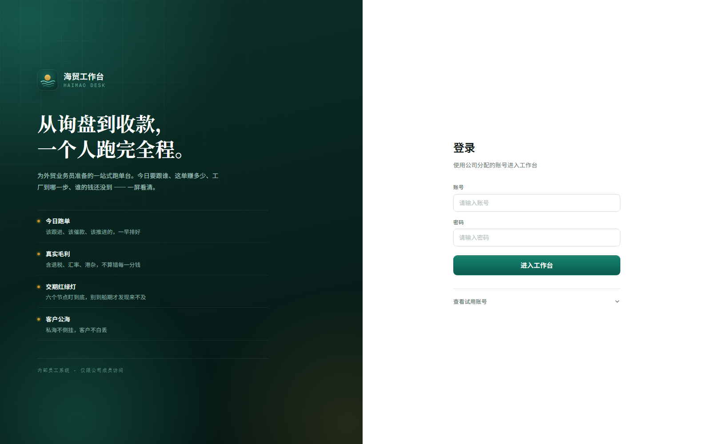
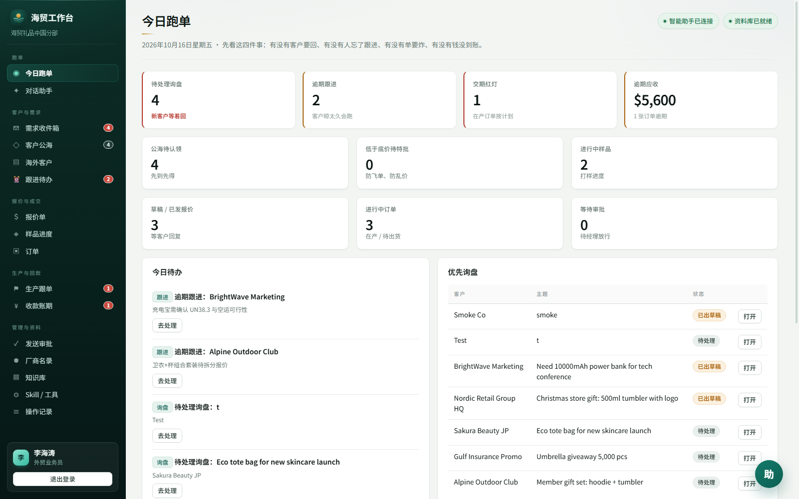
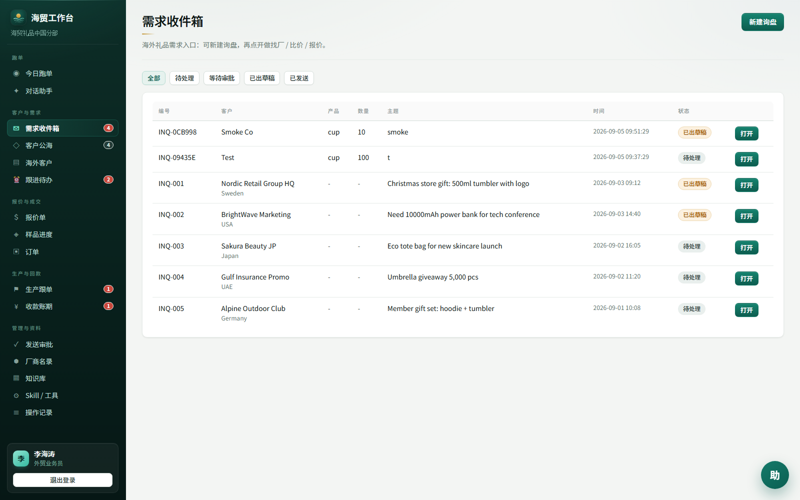
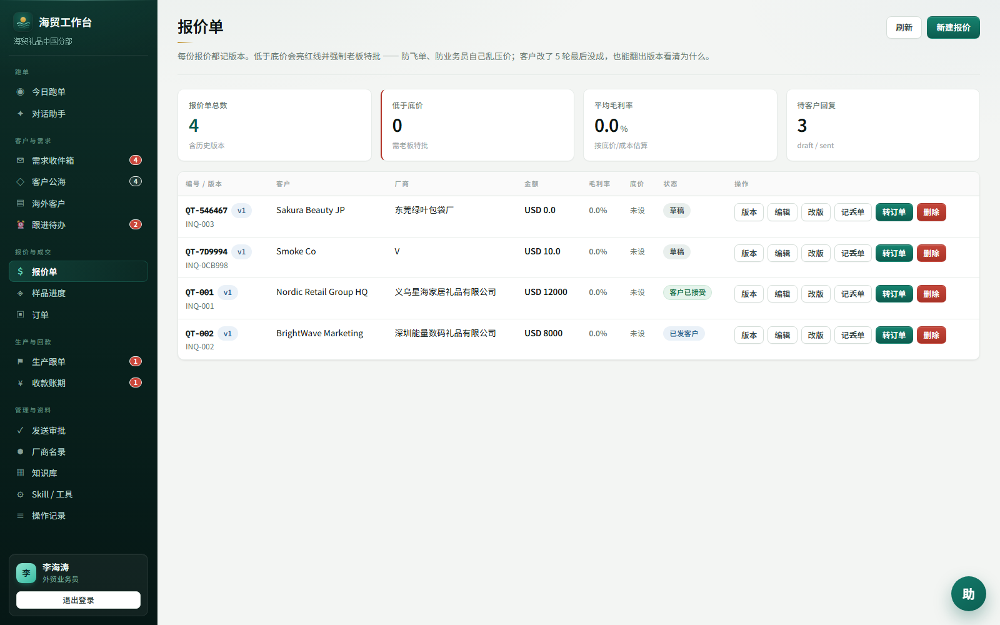
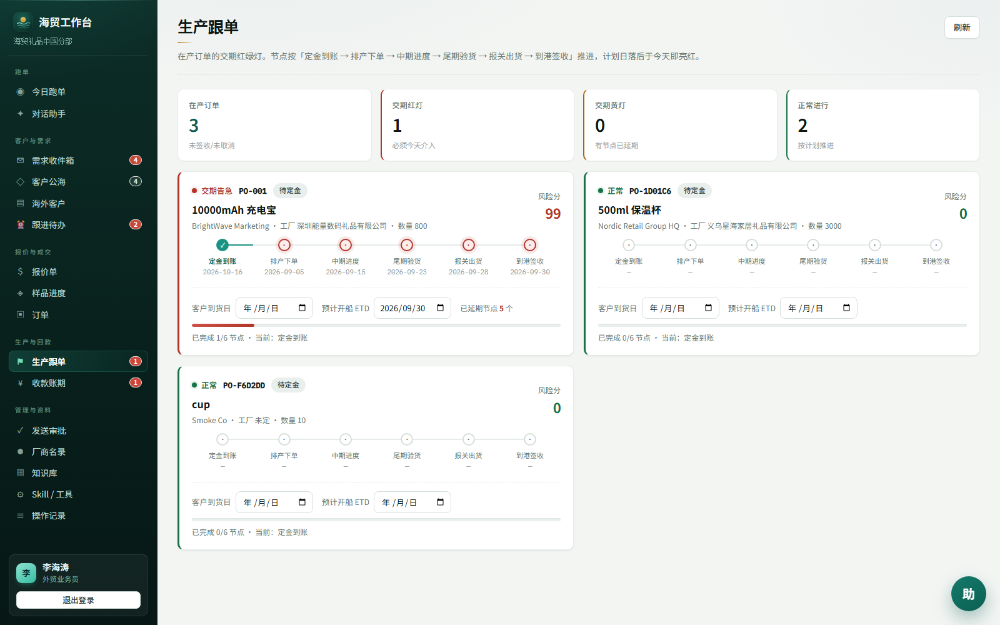
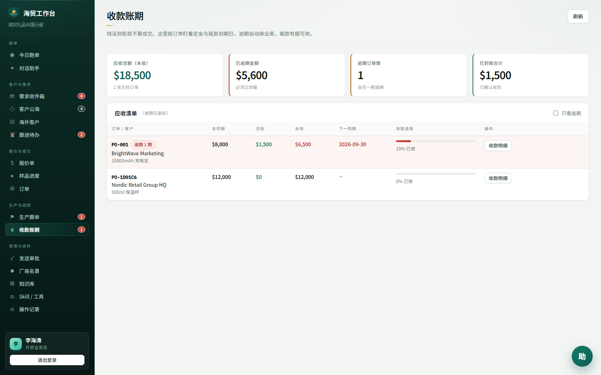
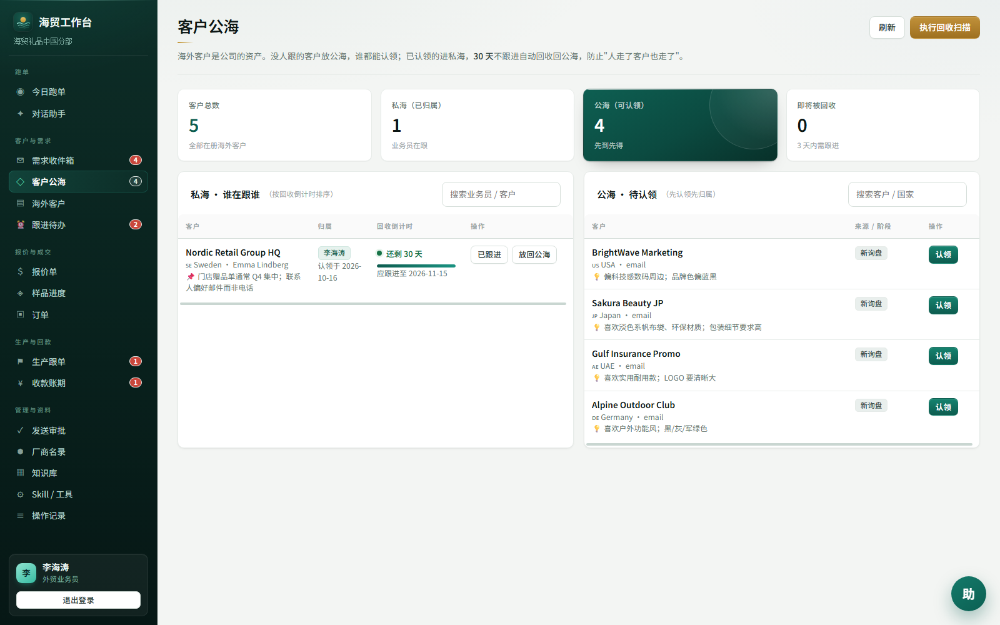
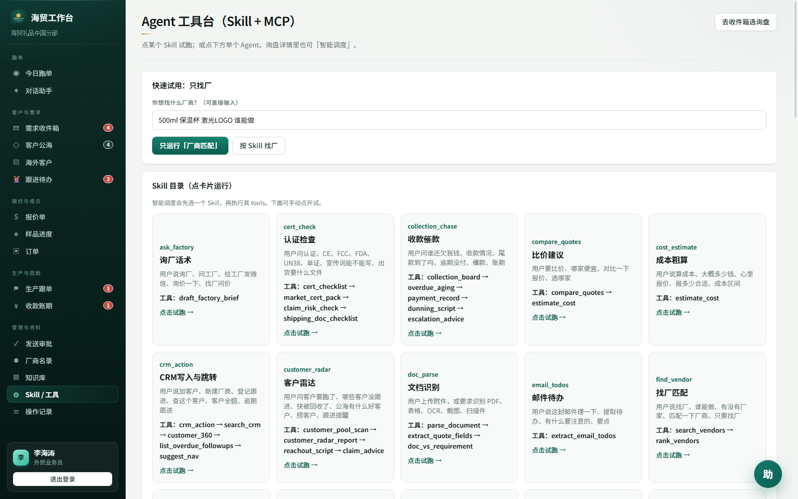
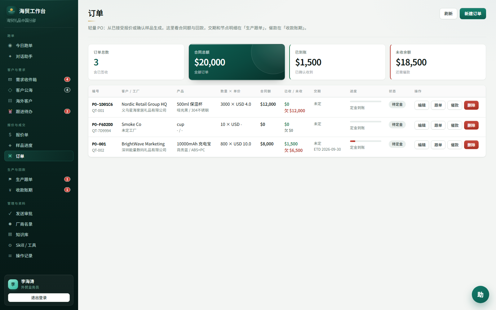
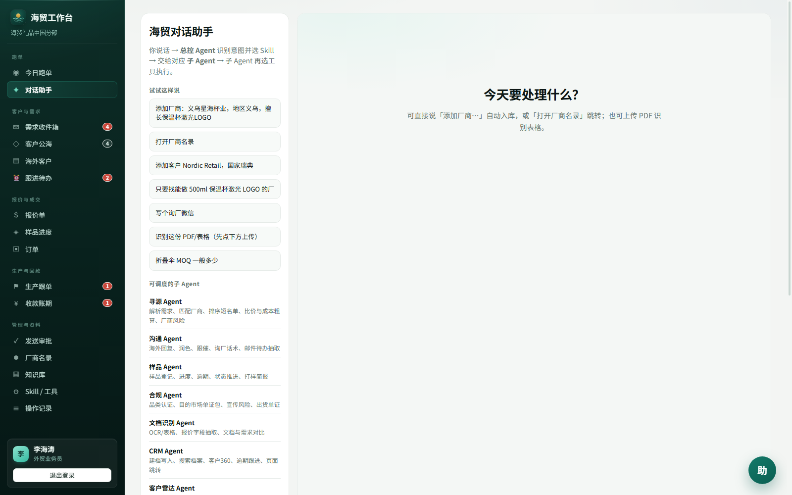

# 海贸工作台 Haimao Desk

> 面向 1–20 人外贸礼品团队的全流程内部系统：**询盘 → 找厂比价 → 报价（红线+老板特批）→ 转订单 → 生产跟单 → 收款催款**，由一套 MCP 风格按需调度的多 Agent 驱动。



## 演示截图（完整跑单链路）

| 页面 | 看什么 |
|------|--------|
|  | 今日看板：待处理询盘 / 逾期跟进 / 交期红灯 / 逾期应收，一张图知道"先干哪四件事" |
|  | 询盘建档 + Agent 识别待办 + 回复草稿 |
|  | 报价版本历史，低于底价自动亮红线并强制老板特批 |
|  | 订单 6 节点红绿灯（定金→排产→中期→尾期→报关→到港），逾期自动算风险分（红灯 99） |
|  | 30/70 收款计划 + 账龄分层催款 |
|  | 公海/私海 + 30 天不跟进自动回收 |
|  | 21 个 Skill 一键试跑，每个 Skill 背后是按需调度的工具链 |
|  | 报价一键转订单，自动生成里程碑与收款计划 |
|  | 总控 → Skill → 12 个领域 Agent → 工具 的分层对话入口 |

## 快速开始

```bash
# 后端（8000）
pip install -r requirements.txt
python run_api.py

# 前端（5173）
cd frontend
npm install
npm run dev
```

打开 http://localhost:5173 ，演示账号（密码均为 `123456`）：

| 账号 | 姓名 | 角色 |
|------|------|------|
| `liht` | 李海涛 | 外贸业务员 |
| `chenxw` | 陈晓雯 | 经理/管理员 |
| `zhoum` | 周敏 | 老板/特批 |

LLM 走 OpenAI 兼容接口（环境变量 `API_KEY` / `Apikey`），**不配 key 也能跑**：规则匹配与全部业务流不依赖 LLM。

## 测试

```bash
pip install -r requirements-dev.txt
python -m pytest          # 152 例，约 36 秒
```

测试集中在**最容易算错钱的地方**，而不是凑行覆盖率：

- `test_profit.py`（22 例）：利润算术、缺关键成本强制 0 毛利+谨慎、汇兑压力（人民币升值 3%）
- `test_quotation_floor.py`（28 例）：底价红线、老板特批生命周期、版本归档——还借此抓出一个 `"1,000"` 被 `float()` 静默丢数据的真实 bug
- `test_customer_pool.py`（27 例）：公海/私海流转、回收边界（到期当天不收、过一天才收）
- `test_order_tracking.py`（50 例）：6 节点里程碑推进、状态联动、逾期风险分、账龄分层
- `test_approval_flow.py`（25 例）：审批闸门与询盘状态机

## 架构

```
浏览器 (Vue3 + Vite)
   │  REST
FastAPI (app.py 仅装配, 10 个业务域 router)
   │
Supervisor 总控 ──► Skill 层 (21 个 YAML 编排) ──► 12 个领域 Agent ──► 工具注册表 (MCP 风格按需调用)
   │                                                        │
   └── RuntimeStore (JSON 文件 + 写锁 + 原子写)              └── LLM (OpenAI 兼容, 可缺省)
        repositories/ 按域拆分: customer / quotation / order / vendor / audit ...
```

四个领域 Agent 例子：`sourcing_agent`（找厂比价）、`profit_agent`（成本毛利测算）、`sales_guard_agent`（承诺红线守护）、`collection_agent`（催款话术与升级）。

## 关键技术决策（为什么这么做）

### 1. 为什么默认 JSON 文件存储，而不是 MySQL？

目标用户是 1–20 人小团队，**交付成本比吞吐量重要**。单机 JSON + 写锁 + 原子写（tmp + replace）在几十个客户、几百张报价的量级完全够用，且免去部署数据库、连接池、迁移脚本三件套。代码上做了分层隔离：所有业务不变量都在 `repositories/` 层（纯函数 normalizers + 按域 repo），`store.py` 只管"数据放哪、怎么写"。**真要迁 MySQL，换一层实现即可**——152 个测试就是迁移安全网。Redis/MySQL FAQ 缓存层同理：连不上就自动降级 BM25，系统不瘫痪。

### 2. 为什么是 MCP 风格按需调度，而不是固定流水线？

外贸请求的差异极大：一句"帮我找 500ml 保温杯激光 LOGO 的厂"只需要寻源工具链，"这个单子能不能接"只需要利润测算。固定流水线每步都跑，**又慢又贵还会串味**。这里 Supervisor 只做意图识别 → 选一个 Skill → Skill 按声明拉起工具链，规则可命中就不过 LLM。这让"哪个 Agent 答了什么"全程可审计（每步落 audit log），也便于新增领域：写一个 YAML Skill + 注册几个 tool 即可，不碰编排核心。

### 3. 为什么拆 12 个领域 Agent，而不是一个大 Agent？

提示词给一个 Agent 塞下询盘、比价、报价、跟单、催款全部规则，上下文互相污染、改动牵一发动全身。按业务域拆开后，每个 Agent 的系统提示词只含本域规则与工具清单，可独立评审与迭代；`SKILL_TO_AGENT` 映射表让 Skill 与 Agent 解耦。

### 4. 12% 底价红线从哪来？

不是拍脑袋：礼品外贸毛利率普遍被海运费与汇率两头挤压，公司口径是**低于 12% 必须老板特批**。实现上把口径固化成代码常量 `MARGIN_FLOOR_POLICY = 0.12`，配合三层防线：

- 利润测算缺**关键成本**（工厂采购价/退税率）时毛利强制 0、结论"谨慎"——宁可误报不漏报；
- 报价低于底价 → 状态自动 `boss_approved=false`，业务员**无权发送**（403）；
- 老板特批后若再改价，特批**自动撤销**、版本归档 +1，防止"先批后改"绕过红线。

### 5. 其他取舍

- **发送审批闸门**：AI 起草的对外承诺必须经人工审批才发出，这是对 LLM 幻觉最便宜的防御。
- **成本口径**：工厂采购价按单价×数量（unit-based），其余成本项按总额（total-based）；退税基数是工厂采购额而非营收——这是行业真实口径，测试中有对应断言。
- **知识库**：BGE-M3 + Milvus hybrid（WeightedRanker 0.7/0.3）+ 父子分块，本地没装 Milvus 时自动降级 BM25，演示环境零依赖。

## 文档

- [docs/项目文档.md](docs/项目文档.md) — 产品 / 架构 / 数据 / API 全景
- [docs/技术细节与参数手册.md](docs/技术细节与参数手册.md) — 配置、工具入参出参
- [docs/MCP式Agent说明.md](docs/MCP式Agent说明.md) — 调度机制详解
- [docs/RAG-Milvus父子分块.md](docs/RAG-Milvus父子分块.md) — 检索链路
- [docs/完整流程图.html](docs/完整流程图.html) — 业务流程图（浏览器打开）

## 目录结构

```
backend/
  api/            # app.py 装配 + deps/schemas + routers/（10 个业务域）
  agents/         # supervisor / skills(21 YAML) / domain_agents(12) / tools
  services/
    store.py      # RuntimeStore：数据落点 + 写锁 + 原子写（~350 行）
    repositories/ # 按域仓储 + 纯函数 normalizers（业务不变量都在这）
  core/           # 配置、认证、LLM 客户端
frontend/src/     # Vue3 视图（登录/看板/收件箱/报价/跟单/收款/公海/Agent 台…）
tests/            # 152 例 pytest，聚焦资金与红线规则
scripts/          # 初始化 Milvus/FAQ、构建知识库、CDP 截图
```
